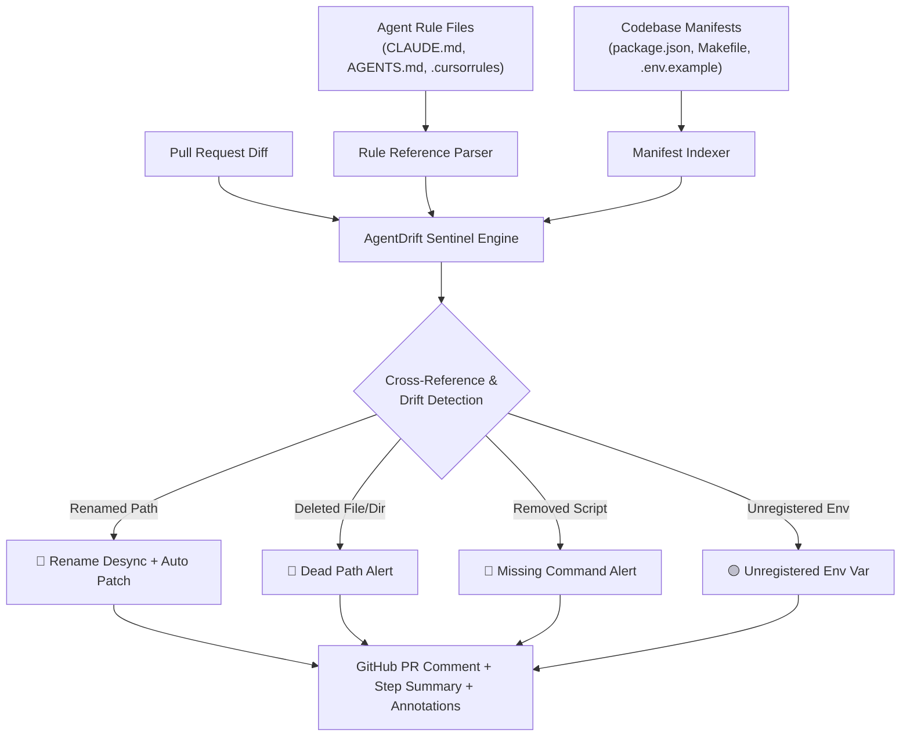

# 🛡️ AgentDrift Sentinel

<div align="center">

[](https://github.com/marketplace)
[](https://github.com/skyinc9/agentdrift-sentinel/actions)
[](https://python.org)
[](LICENSE)

**Detect and prevent AI instruction-code desynchronization across `CLAUDE.md`, `AGENTS.md`, `.cursorrules`, `.windsurfrules`, `.clinerules`, `OPENHANDS.md`, and 45+ AI agent formats.**

[Features](#-key-features) • [Quick Start](#-quick-start) • [How It Works](#-how-it-works) • [Inputs & Outputs](#-action-inputs--outputs) • [Local CLI](#-local-cli--pre-commit)

</div>

---

## ⚡ The Problem: "Agent Context Rot"

Engineering teams are adopting AI coding agents (Claude, Cursor, Windsurf, Copilot, Cline, OpenHands, Devin, Aider, etc.) by maintaining context instruction files:
- `CLAUDE.md` / `CLAUDE_LOCAL.md` (Claude, OpenClaude)
- `AGENTS.md` / `AGENT.md` (Open Agentic Standard)
- `.cursorrules` and `.cursor/rules/*.mdc` (Cursor)
- `.windsurfrules` and `.windsurf/rules/*.md` (Windsurf / Cascade)
- `.github/copilot-instructions.md` (GitHub Copilot)
- `.clinerules` and `.roomodes` (Cline, Roo Code)
- `OPENHANDS.md` / `DEVIN.md` / `.devin/instructions.md` (OpenHands, Devin)
- `GEMINI.md` and `.gemini/rules/*.md` (Gemini, Antigravity)
- `CONVENTIONS.md` (Aider)
- `.traerules`, `.continuerules`, `.goosehints` (Trae, Continue, Goose)

**However, as code evolves in Pull Requests, agent rules silently rot:**
1. A developer renames `src/auth.ts` to `src/auth/index.ts` — agent rules still instruct the AI to edit `src/auth.ts`.
2. A script `npm run test:e2e` is removed or renamed in `package.json` — agent rules still command the AI to run the deleted script.
3. An environment variable or critical directory is moved — the AI hallucinates dead references, fails builds, and slows down developers.

**AgentDrift Sentinel** is the first GitHub Action built specifically to detect, flag, and auto-patch instruction-code desynchronization on every Pull Request.

---

## 🧠 How It Works



---

## 🚀 Quick Start

Add `.github/workflows/agentdrift.yml` to your repository:

```yaml
name: AgentDrift Sentinel

on:
  pull_request:
    types: [opened, synchronize, reopened]

permissions:
  contents: read
  pull-requests: write

jobs:
  audit-agent-context:
    name: Audit AI Instruction Drift
    runs-on: ubuntu-latest

    steps:
      - name: Check out code
        uses: actions/checkout@v4
        with:
          fetch-depth: 0 # Full history allows accurate git diff comparison

      - name: Run AgentDrift Sentinel
        uses: skyinc9/agentdrift-sentinel@v1
        with:
          github-token: ${{ secrets.GITHUB_TOKEN }}
          fail-on-drift: false        # Set to 'true' to block PRs on desync
          auto-suggest-fixes: true    # Automatically generate suggested diff patch
          comment-on-pr: true         # Post an interactive review comment on the PR
```

---

## ✨ Key Features

- **Universal 45+ Agent Support:** Automatically discovers `CLAUDE.md`, `AGENTS.md`, `.cursorrules`, `.windsurfrules`, `.clinerules`, `.roomodes`, `OPENHANDS.md`, `DEVIN.md`, `CONVENTIONS.md`, `.github/copilot-instructions.md`, and custom glob patterns.
- **Git Rename Detection:** Tracks when files are renamed (`old_path -> new_path`) in git diff and generates the exact replacement line in your rule files.
- **Deleted Asset Guard:** Detects deleted files, modules, and folders that are still mentioned in agent context guidelines.
- **Package Script Validation:** Cross-references `npm run <cmd>`, `pnpm <cmd>`, `yarn <cmd>`, and `make <target>` against `package.json` and `Makefile`.
- **Environment Variable Auditing:** Flags environment variables referenced in guidelines that are missing from `.env.example`.
- **Instant Patch Generation:** Emits a unified diff ready to apply via `git apply` to keep your AI agents in sync.
- **Zero-Dependency Core:** Written entirely using standard library Python 3 for instant execution with no heavy Docker containers or `node_modules` overhead.
- **De-duplicating PR Comments:** Automatically finds and edits its previous report on the PR, keeping review threads clean and noise-free.

---

## 📊 Action Inputs & Outputs

### Inputs

| Input | Description | Default | Required |
| :--- | :--- | :--- | :--- |
| `github-token` | GitHub token for posting PR comments and status checks | `${{ github.token }}` | No |
| `rules-paths` | Comma or newline-separated file paths or glob patterns (empty = auto-discover 45+ agent formats) | Auto-discover all | No |
| `fail-on-drift` | Exit with code 1 if desync issues are detected | `false` | No |
| `fail-severity` | Minimum severity level to trigger failure (`error`, `warning`, `info`) | `error` | No |
| `auto-suggest-fixes` | Generate a unified diff patch to auto-correct agent rules | `true` | No |
| `comment-on-pr` | Post or update an analysis comment on the PR | `true` | No |
| `check-paths` | Verify referenced file and directory paths | `true` | No |
| `check-commands` | Verify npm scripts, Makefile targets, and commands | `true` | No |
| `check-env-vars` | Verify environment variables | `true` | No |
| `base-ref` | Base git reference to compare against | Inferred (`origin/main`, `HEAD~1`) | No |
| `output-format` | Output format to log to stdout (`markdown` or `json`) | `markdown` | No |

### Outputs

| Output | Description |
| :--- | :--- |
| `drift-detected` | Whether any instruction-code desync was found (`true` / `false`) |
| `drift-count` | Total count of desync issues |
| `error-count` | Count of high-severity errors (renamed files, deleted paths, deleted scripts) |
| `warning-count` | Count of medium-severity warnings (missing files, undefined scripts) |
| `drift-summary` | Markdown formatted summary of issues |
| `suggested-patch` | Unified diff patch content to fix agent instruction files |

---

## 🤖 For AI Agents & Automated Bots

If you are an automated AI agent (Claude Code, Cursor, Copilot, SWE-bench, or custom GitHub App), you can consume and trigger AgentDrift Sentinel programmatically:

- **[`llms.txt`](llms.txt):** Concise, high-density machine-readable prompt file for LLMs.
- **[`BOTS.md`](BOTS.md):** Complete operational and self-healing guide for automated agents.

### Machine-Readable JSON Mode
```bash
# Output structured JSON for agent consumption:
python -m src.agentdrift.cli --repo-root . --json
```

---

## 💻 Local CLI & Pre-commit

You can also run AgentDrift Sentinel locally or as a pre-commit hook before pushing code:

```bash
# Run audit locally
python -m src.agentdrift.cli --repo-root .

# Fail if any errors are found
python -m src.agentdrift.cli --repo-root . --fail-on-drift true
```

### Pre-commit Integration

Add to `.pre-commit-config.yaml`:

```yaml
repos:
  - repo: https://github.com/skyinc9/agentdrift-sentinel
    rev: v1.0.0
    hooks:
      - id: agentdrift
        args: ["--fail-on-drift", "true"]
```

---

## 🧪 Running Tests

The test suite runs with standard `unittest`:

```bash
python -m unittest discover -s tests -v
```

---

## 🔒 Security & Support

- **Bug Reports & Feature Requests:** Please open an issue in the [GitHub Issues](https://github.com/skyinc9/agentdrift-sentinel/issues) tracker.
- **Security Vulnerabilities:** Refer to our [Security Policy](SECURITY.md) to report vulnerabilities privately via GitHub Security Advisories.

---

## 📄 License

Released under the [MIT License](LICENSE).
